# API REST de Series

API REST para gestionar un catálogo de series de televisión, con operaciones
CRUD. Desarrollada con Spring Boot, Spring Data JPA, Lombok y base de datos H2.

## Tecnologías
- Java 17
- Spring Boot 4.1.2
- Spring Data JPA
- H2 Database (almacenada en archivo)
- Lombok
- Maven

## Estructura del proyecto
```
src/main/java/com/LozMoncayo/app/_1/
├── controller/   → SerieController (endpoints REST)
├── service/      → SerieService (lógica de negocio)
├── repository/   → SerieRepository (acceso a datos con JPA)
├── models/       → Serie (entidad)
└── Application.java
```

## Requisitos
- JDK 17 o superior
- Maven (o usar el wrapper incluido `mvnw`)

## Cómo ejecutar
1. Clonar el repositorio:
   ```
   git clone https://github.com/lozanoash/Api-Rest-de-Series.git
   cd <carpeta-del-proyecto>
   ```
2. Ejecutar:
   - Windows: `mvnw.cmd spring-boot:run`
   - Linux/Mac: `./mvnw spring-boot:run`
3. La API queda disponible en `http://localhost:9090`.

## Consola H2
- URL: `http://localhost:9090/h2-console`
- JDBC URL: `jdbc:h2:file:./data/seriesdb`

## Entidad Serie
| Campo | Tipo | Descripción |
|---|---|---|
| id | Long | Identificador único (autogenerado) |
| titulo | String | Nombre de la serie |
| plataforma | String | Netflix, HBO, Prime, Disney+, etc. |
| calificacion | Double | Calificación del 1 al 10 |

## Endpoints
| Método | URL | Descripción | Respuestas |
|---|---|---|---|
| GET | /api/series | Listar todas las series | 200 |
| GET | /api/series/{id} | Buscar una serie por ID | 200, 404 |
| POST | /api/series | Crear una serie | 201, 400 |
| PUT | /api/series/{id} | Actualizar una serie | 200, 404 |
| DELETE | /api/series/{id} | Eliminar una serie | 204, 404 |

Ejemplo de body para POST y PUT:
```json
{
  "titulo": "Dark",
  "plataforma": "Netflix",
  "calificacion": 8.8
}
```

## Pruebas

Las pruebas se realizaron con Talend API Tester. Las capturas están en la
carpeta `Capturas/`.

### 1. Crear serie (POST) - 201 Created
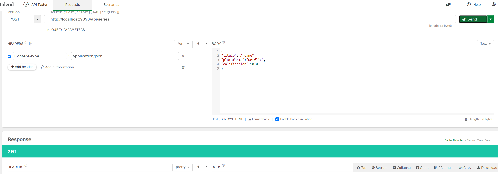

### 2. Listar todas las series (GET) - 200 OK
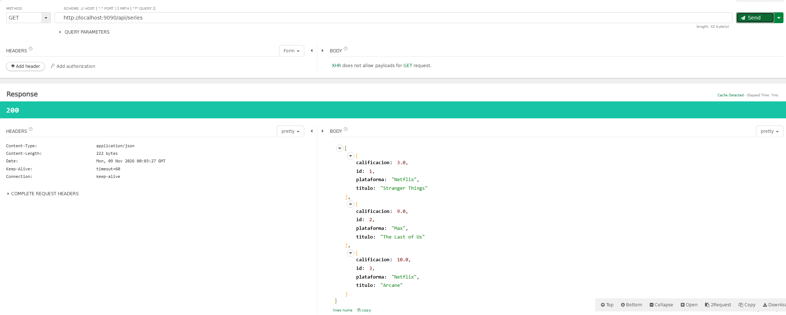

### 3. Buscar serie por ID (GET) - 200 OK
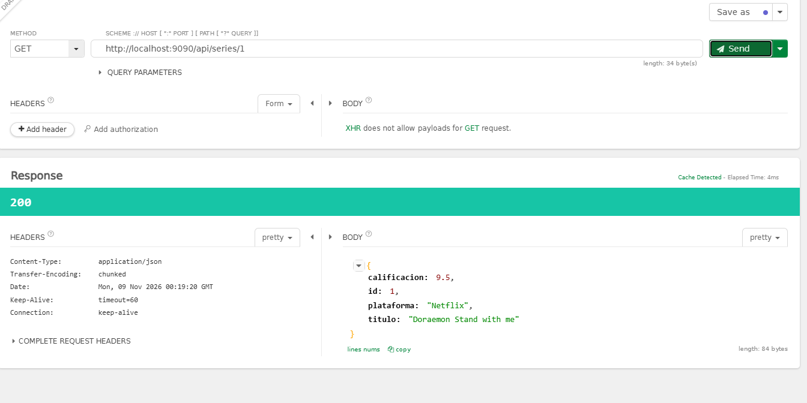

### 4. Buscar serie con ID inexistente (GET) - 404 Not Found
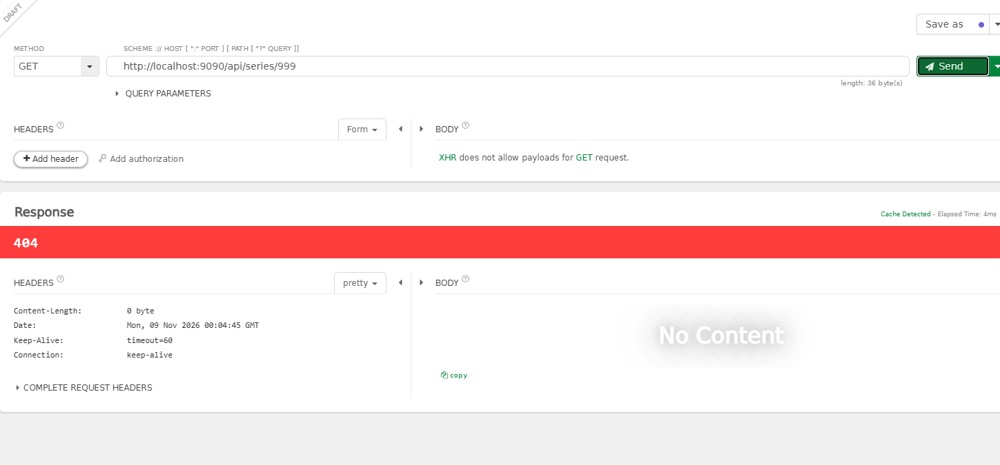

### 5. Actualizar serie (PUT) - 200 OK
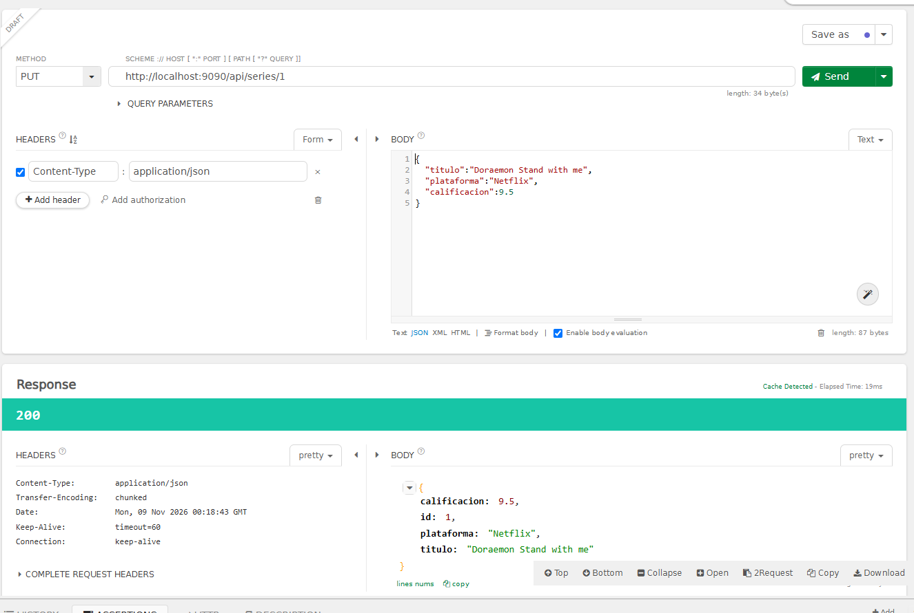

### 6. Actualizar serie con ID inexistente (PUT) - 404 Not Found
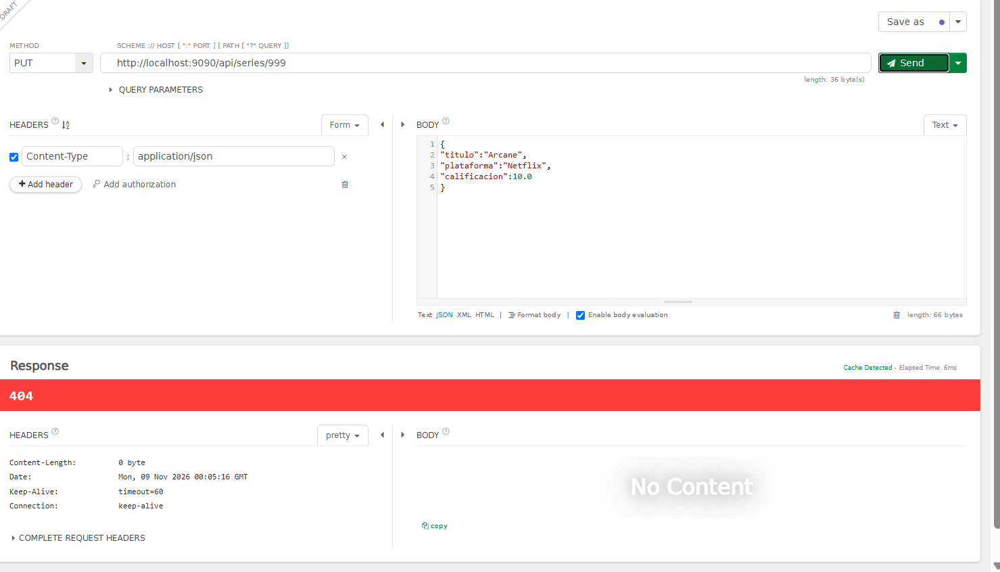

### 7. Eliminar serie (DELETE) - 204 No Content
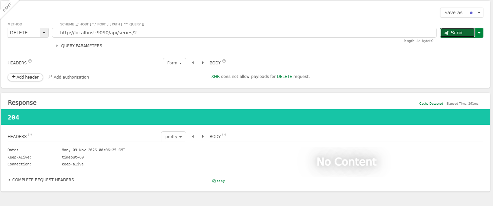

### 8. Verificar que la serie eliminada ya no existe (GET) - 404 Not Found
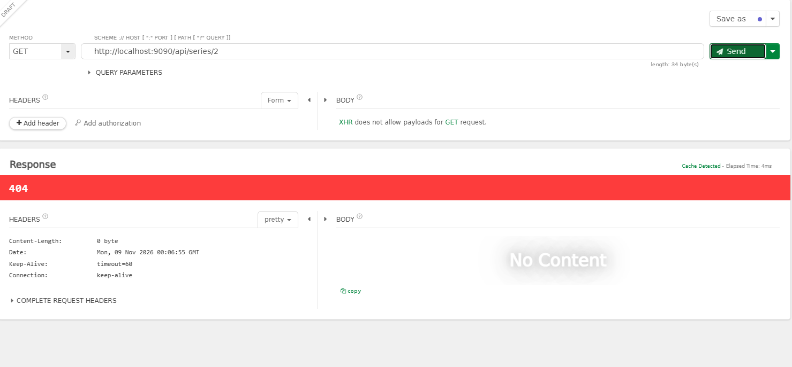

### 9. Eliminar serie con ID inexistente (DELETE) - 404 Not Found
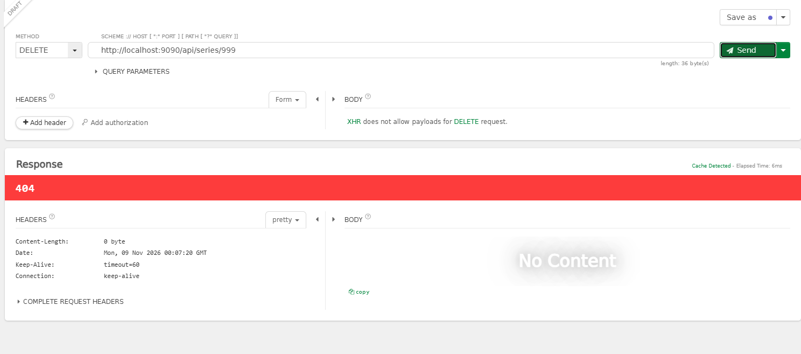

### 10. Datos inválidos (POST) - 400 Bad Request
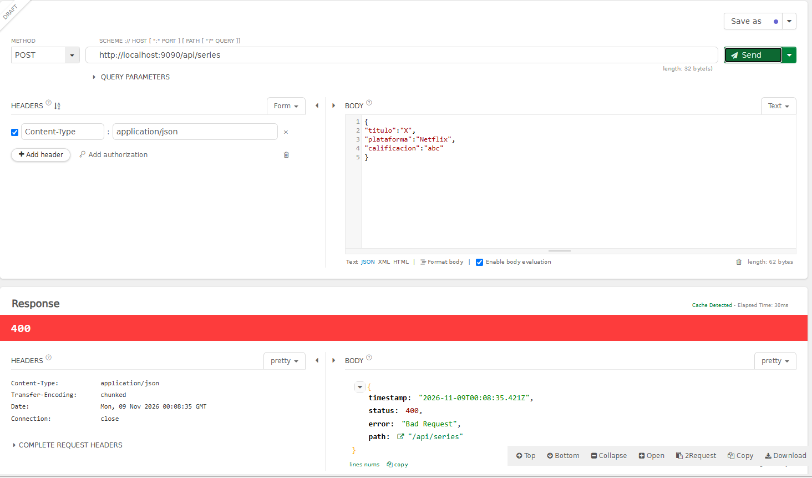

### Otras capturas
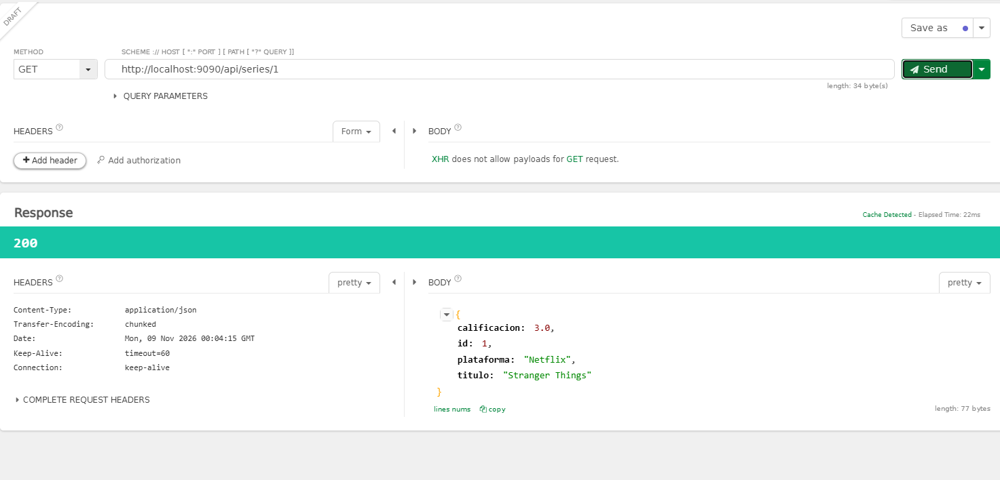
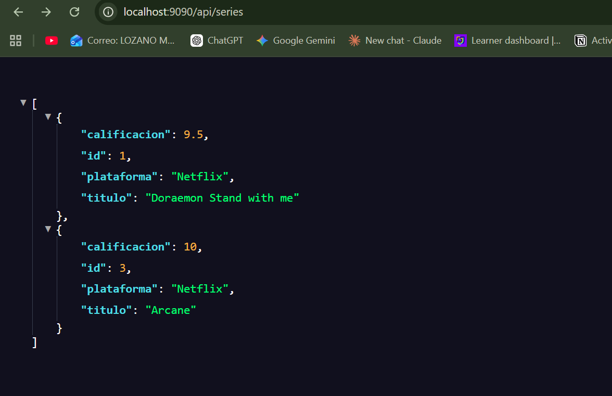

## Casos límite probados
- Buscar, actualizar o eliminar un ID que no existe - 404
- Enviar un JSON con tipos inválidos - 400

## Autor
Ashley Lozano